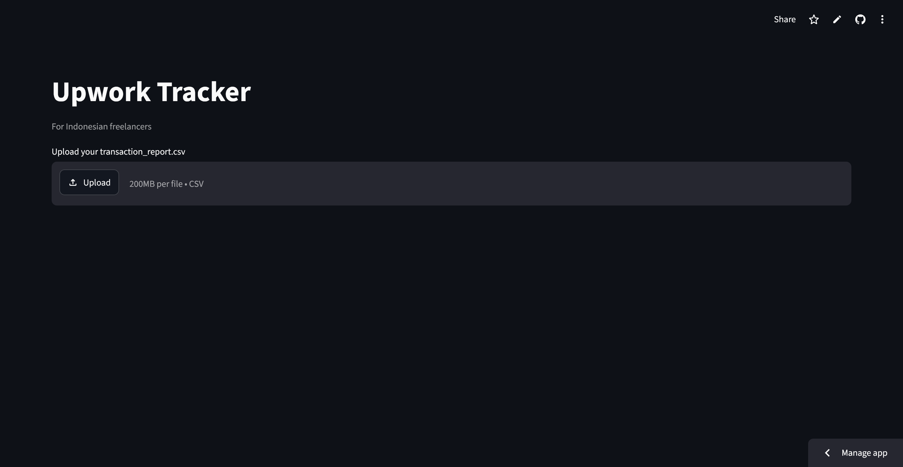

# Freelance Tracker

A Python tool for Indonesian freelancers. Reads your Upwork transaction report, calculates earnings, fees, and Connects spending, converts to IDR, estimates tax, and tracks your Connects ROI.

Runs as both a command-line tool and a Streamlit web app.



**Live app:** https://upwork-id.streamlit.app

## Features

- Auto-detects newest report from Downloads
- Computes gross, fees, Connects, net
- Live USD → IDR exchange rate
- Month-by-month net breakdown
- Connects ROI by month
- Top clients by earnings
- Current balance
- Tax estimate: UMKM 0.5% and NPPN
- Saves summary to `output/summary.txt`
- Web UI with charts

## How to run

Install once:

```
python -m pip install -r requirements.txt
```

Command line:

```
python tracker.py
```

Web app:

```
python -m streamlit run app.py
```

## How to get your CSV

Upwork → Reports → Transaction History → set dates → Export → CSV. It lands in Downloads.

## Tax note

Estimates only. Verify with a konsultan pajak before filing.

## License

MIT
